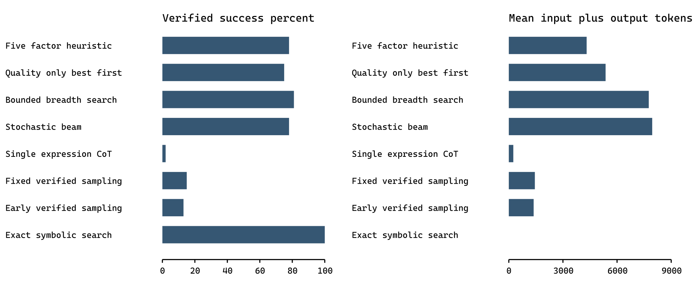

# Cost Aware Heuristic Selection for Language Model Guided Arithmetic Search

Research manuscript draft | Evidence audited on 2 November 2026

## Abstract

Search can improve language-model reasoning by exploring alternatives, but repeated generation and evaluation incur computational cost. We study a five-factor state-selection heuristic combining estimated reduction quality, estimated continuation success, depth, predicted incremental token cost, and diversity. The heuristic operates over an exact arithmetic expression forest: Python constructs legal transitions and checks terminal expressions, while a local Qwen2.5 7B instruction model supplies a shortlist of state ratings. We evaluate eight methods on the original Tree of Thoughts Game of 24 evaluation range and on a separately generated solvable-puzzle set. On 100 original puzzles, the heuristic solves 78%, compared with 81% for a bounded breadth-search adaptation, while reducing average tokens by 44.4% and model calls by 49.2%. Against quality-only best-first search, it solves 78% versus 75% with 19.6% fewer tokens. Across three seeds on 100 generated puzzles, its average success is 82.3%, versus 80.0% for breadth search, with 42.1% fewer tokens. Paired uncertainty intervals do not establish accuracy superiority or noninferiority. An exact symbolic reference solves every evaluated puzzle without model calls, emphasizing that this benchmark supports a study of language-model-guided scheduling rather than a claim that language models are necessary for arithmetic search. We document the implementation, comparator differences, overlap audit, failure modes, and limitations needed to interpret these observations reproducibly.

Keywords: language model reasoning; heuristic search; inference cost; exact verification; Game of 24; evaluation methodology

## 1 Introduction

A language model can generate several plausible continuations of a partial solution, but not every continuation deserves equal computation. A search controller must decide which state to expand, whether to evaluate an alternative, and when to stop. These decisions create an accuracy–cost trade-off: further exploration can discover a solution, but each model call consumes input tokens, output tokens, and elapsed time. The cost of an evaluation prompt can itself exceed the cost of producing a short answer. Consequently, a reasoning method should be evaluated using both task success and actual resource consumption.

The objective of this project is to implement a state-selection function that explicitly incorporates five factors: estimated answer quality, probability-like success estimates, reasoning depth, token or API cost, and search diversity. The implemented system uses those factors as a practical scheduling heuristic. It does not learn an optimal policy, train a success predictor, or optimize a formal accuracy–cost objective end to end. Those stronger objectives remain future extensions. Measuring resource usage is necessary to evaluate the current cost-aware mechanism, even when optimal policy learning is outside its scope.

Game of 24 provides a controlled setting because candidate expressions can be checked exactly. Four positive integers must be combined with binary addition, subtraction, multiplication, division, and parentheses to obtain 24, using each input exactly once. An intermediate state can be represented as a forest of expressions whose values are rational numbers. This representation separates arithmetic legality from language-model preference: the model estimates which legal reductions are promising, while deterministic code determines whether a proposed expression is actually correct.

This separation also makes the benchmark unusually favorable to ordinary symbolic search. We therefore include an exact solver as a visible reference rather than presenting an LLM-guided method as the best way to solve this finite arithmetic task. The central empirical question is narrower: within a common LLM-guided search engine, can a composite state priority reduce model usage relative to simpler selection policies while retaining useful success rates?

The manuscript provides three contributions. First, it specifies the implemented five-factor heuristic and its operational details, including the distinction between exact verification and uncertain LLM ratings. Second, it reports paired comparisons against seven reference methods, separating shared-engine controls from complete-expression samplers and a symbolic solver. Third, it audits the existing experiment artifacts, including expression validity, token accounting, dataset overlap, run completeness, and uncertainty. No new inference was performed to write this paper, and no unsupported claim of state-of-the-art performance is made.

## 2 Related work and scope

Tree of Thoughts introduces exploration over intermediate reasoning units with language-model evaluation and search [1]. It motivates our comparison between different state-selection mechanisms. Our breadth-search comparator is deliberately described as a bounded local adaptation: it uses exact arithmetic transitions, a two-number endgame checker, deferred states, and a small local model. These changes prevent direct identification with the original paper's GPT-4 configuration or reported accuracy.

Self-consistency samples alternative reasoning paths and aggregates their answers [2]. In our Game of 24 implementation, the method historically named self_consistency instead samples six complete expressions and succeeds if any expression passes an exact verifier. That is a fixed-budget verified sampling comparator, not majority-vote self-consistency. We use its operational name throughout the results. An additional early-stopping verified sampler isolates the effect of terminating after the first checked solution, although the two samplers use different method-specific random seeds and therefore do not consume identical sample sequences.

Thought of Search emphasizes soundness, completeness, and efficiency, and uses language models to construct search components rather than repeatedly perform the search itself [3]. It is relevant to our separation of deterministic transitions from model-based guidance. However, our transition and verification code is supplied by the implementation; it is not generated anew by the model during each experimental problem. We do not label our system a reproduction of Thought of Search.

ChemReasoner combines language-model hypotheses with domain-grounded feedback for catalyst discovery [4]. Its relevance is architectural: an external process can constrain or evaluate model-guided exploration. Quantum-chemical feedback differs substantially from our exact arithmetic checker, and ChemReasoner is not an experimentally comparable Game of 24 baseline here.

Li's survey of LLM test-time compute through search distinguishes task formulation, model roles, and search procedures [5]. We follow that spirit by stating precisely which parts of the system are deterministic, which call the model, and which search controls differ. The Qwen2.5 7B instruction model is the common language-model family used in our recorded local experiments [6]. The project evaluates a concrete implementation of familiar ingredients; it does not establish that their weighted combination is theoretically novel, calibrated, or optimal.

## 3 Task and state representation

### 3.1 Arithmetic problem

Let the input be a multiset of four integers. The goal is an expression that evaluates exactly to 24 and has the same multiset of integer leaves as the input. Repeated input numbers remain distinct resources in the multiset accounting. Fractional and negative intermediate values are legal. Additional constants, powers, concatenation, and unary operators are not accepted by the verifier.

Each term contains a rational value and the expression that produced it. A state consists of the remaining terms, its depth, its parent identifier, and model-derived quality and success scores. One transition chooses two distinct terms and combines them with an allowed binary operator. The selected terms are removed and replaced by the resulting term, so each arithmetic transition reduces the number of terms by one. From four terms, three arithmetic reductions suffice to reach a one-term expression.

$$ s = ({(vᵢ, eᵢ)}ᵢ₌₁ᵐ, d, Q, P),    m ∈ {1, 2, 3, 4}. $$

For example, the input [3, 3, 8, 8] admits the verified expression 8 / (3 − 8 / 3) = 24. Its intermediate values include 8/3 and 1/3. Rational arithmetic is necessary to preserve this reasoning exactly; floating-point tolerances would introduce unnecessary ambiguity. This example illustrates the representation and is not presented as a selected experimental success case.

### 3.2 Legal transitions and duplicate states

The transition generator enumerates ordered pairs for subtraction and division and avoids redundant symmetric addition and multiplication operations. Division by zero is skipped. Children are deduplicated by their sorted multiset of remaining rational values. The same key is used for global duplicate detection. Distinct expression histories with the same remaining values share the same arithmetic reachability problem, although the retained expression provides the concrete witness needed for final verification.

The implementation is therefore a graph search over canonical arithmetic states, with one retained parent relation for tracing, rather than a pure tree in which every syntactically different derivation remains separate. Expression histories are retained for reconstruction and branch checking, but equivalent numeric states do not require separate expansion.

### 3.3 Verification and local endgames

Final expressions are parsed into Python abstract syntax trees; they are never evaluated through unrestricted eval. The checker permits only approved binary operations and positive integer leaves, verifies the exact input-leaf multiset, and evaluates using fractions. A success requires exact equality to 24. This establishes soundness of recorded positive solutions under the stated operator rules; it does not establish completeness of a budget-limited search.

When a selected state has at most two terms, the engine checks its remaining arithmetic combinations locally without an LLM call. This two-number endgame routine is available to all four guided-search policies. It is not available as a constructive procedure to the complete-expression sampling comparators, although their final expressions use the same verifier. The distinction is important: a guided-search advantage over sampling includes the benefit of the shared symbolic machinery, not just the contribution of the proposed heuristic.

## 4 Five factor heuristic

### 4.1 Quality and success estimates

For each expansion with more than two terms, the engine enumerates all legal children and sends their identifiers and remaining rational values to the model. One deterministic-temperature rating call requests a shortlist of at most six candidate identifiers. For each shortlisted child, the model supplies quality Q and success P in [0,1], together with a short reason. Quality asks how useful the reduction is for solving the task; success asks whether continued search is likely to finish.

These scores are subjective model outputs. They are not probabilities obtained from calibrated outcome data, and the system does not assume that a score of 0.8 implies an 80% empirical success rate. Q and P may be highly correlated. New children not included in the valid shortlist receive Q = P = 0, whereas the initial state begins at 0.5 for both quantities. Unrated legal children are retained rather than discarded, so a failed or incomplete rating does not automatically remove a legal arithmetic branch.

### 4.2 Depth and incremental cost

The depth contribution scales the arithmetic depth by three and multiplies it by residual uncertainty. A deep state with a high success estimate is therefore penalized less strongly than an equally deep uncertain state. This is a design choice, not an admissible distance-to-go estimate.

$$ D(s) = [d(s) / 3] [1 − P(s)]. $$

The cost proxy estimates the additional expense of processing the current state. Let a be an exponentially smoothed estimate of rating-call output tokens, initialized to 260. After a rating response of y output tokens, a is updated as 0.7a + 0.3y. For states with more than two terms, the proxy adds 200 tokens per remaining term to approximate prompt burden. It assigns zero predicted LLM cost to states handled entirely by the local endgame checker.

$$ Ĉ(s) = 0 if m ≤ 2; otherwise Ĉ(s) = a + 200m. $$

$$ C(s) = min(1, Ĉ(s) / 4000),    a ← 0.7a + 0.3y. $$

The proxy is not the total cost already spent along the path. It is also not a trained predictor of the cost of the entire remaining solution. It omits several sources of variation, including the exact length of candidate lists and the number of future expansions. Actual input and output tokens are measured separately from model responses for reporting. This separation prevents the proxy from being mistaken for an observed cost or a dollar-valued API charge.

### 4.3 Search diversity

For each state, the engine forms a multiset of remaining rational values. It computes a multiset Jaccard similarity against every previously expanded state. Novelty is one minus the maximum such similarity; it is one when no state has yet been expanded. The diversity contribution is then gated by the geometric mean of Q and P, reducing the reward for states that are novel but assessed as unpromising.

$$ J(A,B) = |A ∩ B| / |A ∪ B|,    V(s) = 1 − max J(M(s), M(x)). $$

Here the maximum ranges over expanded states x, and the intersection and union use multiset counts. Diversity is measured relative to expansion history, not semantic embeddings and not only the current frontier. It measures differences in arithmetic representations; it does not prove independence between reasoning paths.

### 4.4 Composite selection score

The priority score combines positive quality, positive estimated success, negative depth and cost terms, and quality-gated novelty. The five nonnegative weights sum to one. The implemented values are fixed configuration choices rather than learned parameters.

$$ H(s) = 0.35Q(s) + 0.30P(s) − 0.05D(s) − 0.15C(s) + 0.15V(s)√(Q(s)P(s)). $$

States with higher H are preferred; equal priorities are resolved by state identifier. This function satisfies the project requirement that all five factors participate in state selection. However, their individual causal benefits are not established by the current experiments. The quality-only comparator removes the composite ranking, but it is not a complete leave-one-factor-out ablation. In particular, the cost term may favor a two-number state that is cheap to check but unsolvable; the exact endgame checker resolves that possibility immediately.

The score is not an A* evaluation function with an admissible remaining-cost heuristic. No optimality bound, monotonicity property, or learned decision-theoretic objective is claimed. A future policy could optimize expected success subject to a computational budget, but the present implementation uses a manually specified priority and hard operational limits.

## 5 Search procedure and implementation

### 5.1 Frontier and deferred candidates

The controller maintains an active frontier, a deferred reserve, a visited-state set, and a list of expanded states. It starts from the four-term input state. At each iteration it selects a frontier state according to the chosen policy, optionally conducts a bounded rollout, and expands the selected state if no solution has already been found. More-than-two-term expansion enumerates exact children and rates a shortlist; a smaller state is passed to the local endgame checker.

For best-first policies, at most 12 states remain active after ranking; additional states move to the deferred reserve. The breadth and stochastic-beam adaptations keep two active states. Deferred states are restored when the active frontier empties. This differs from a conventional beam that permanently discards every pruned candidate, and from a globally depth-ordered breadth-first traversal. Budget limits can still prevent many deferred states from ever being explored.

### 5.2 Auxiliary rollouts

The engine can probe a nonroot state with more than two terms when its success estimate lies between 0.35 and 0.65. A rollout asks the model to select one identifier from a list of exact legal moves. Python applies the selected move; it does not trust model-generated arithmetic. The total rollout allowance is two model calls per problem and method, not two calls for every node.

If a probe reaches the local endgame, its completed outcome updates the selected state's confidence as P ← (2P + z)/3, where z is one for a solved probe and zero otherwise. An incomplete or invalid probe does not receive this outcome-based update. The bounded probe is an auxiliary mechanism, not a full Monte Carlo tree-search algorithm with repeated visit counts and upper-confidence selection. All four guided policies share the same rollout mechanism.

### 5.3 Operational algorithm

Algorithm 1 describes the measured heuristic policy. The same transition, rating, verification, and rollout components are reused by the guided controls; only their state ordering and active-frontier policy differ.

```text
Initialize root, active frontier, deferred reserve, visited keys and expansion history.
While no verified answer exists and expansions remain below 64:
    Restore deferred states if the active frontier is empty.
    If neither set contains a state, stop with search exhausted.
    Recompute five-factor priorities and select the highest-priority active state.
    If its score is uncertain and rollout allowance remains, probe legal move IDs.
    If a probe produced a verified answer, stop.
    If at most two terms remain, run the exact local endgame check.
    Otherwise enumerate unseen legal children and request a rated shortlist.
    Add children, keep the best 12 active, and defer the remainder.
Stop if a model-call, token, or context guard prevents further inference.
Return a verified expression if one was found; otherwise return failure.
```

### 5.4 Cost accounting and replay

The local backend records every request, response, input-token count, output-token count, and request duration in append-only journals. It caps model calls at 32, total generated tokens at 6,144, and total input-plus-output tokens at 30,000 for each method and puzzle. Before inference, it uses a conservative UTF-8-byte prompt reserve plus 128 template-overhead tokens and the proposed completion allowance to guard context and remaining budget. This reserve is an approximation; it is not a tokenizer-exact count. Recorded token totals come from the backend after inference.

Completion limits are 1,000 output tokens for full expressions, 700 for rating shortlists, and 260 for rollout move selection, subject to remaining budgets. The context setting is 8,192 tokens. Sampling and expression completion use temperature 0.7; rating uses temperature zero; rollout choice uses temperature 0.4. A failed JSON response is counted as consumed computation even when it contributes no useful ratings.

Request seeds are derived from the run seed, puzzle identifier, method identifier, and call index. Thus methods are evaluated on paired puzzles but do not receive identical random streams. Successful saved calls can be replayed on resume with their original accounting. The experiment manifest records configuration, code fingerprint, model digest, dataset hash, and puzzle IDs. This paper analyzes recorded trials only; it does not rerun inference or revise past outputs.

## 6 Baselines and experimental protocol

### 6.1 Comparator definitions

Table 1 Operational comparator definitions

| Method | Selection or stopping rule | Shared machinery |
| --- | --- | --- |
| Five factor heuristic | Highest composite priority; active width 12 | Legal children, ratings, rollouts, endgame |
| Quality only best first | Highest Q; active width 12 | Same as heuristic |
| Bounded breadth search | Minimum active depth then highest P; width 2 | Same engine, different frontier rule |
| Stochastic beam | Minimum active depth, sample exp(P/0.3); width 2 | Same engine, different selection |
| Single expression CoT | One sampled reasoning and expression response | Exact final verification only |
| Fixed verified sampling | Six full responses; accept any verified solution | Exact final verification only |
| Early verified sampling | At most six responses; stop at first success | Exact final verification only |
| Exact symbolic search | Depth first enumeration until success or exhaustion | Exact arithmetic and local endgame; no model |

The quality-only best-first control is the strongest attribution comparator because it shares the active-frontier size and the deterministic machinery with the proposed method. Differences against breadth and stochastic beam additionally reflect different frontier-size and traversal choices. Differences against complete-expression samplers include exact transition enumeration and endgame assistance. The symbolic reference isolates what ordinary exact search can achieve without the model.

The fixed-budget sampling comparator continues all six draws even after a correct expression has been found. The early-stopping sampler stops on its first verified expression. Since their seeds are method-specific, early stopping is not evaluated on a common set of six sampled expressions; accuracy differences between the two are therefore possible even though they share the verifier and a maximum of six calls. None of these local labels should be presented as a faithful reproduction of every similarly named literature method.

### 6.2 Datasets and run selection

The main external benchmark is the original ToT repository's Game of 24 CSV, using zero-based rows 900 through 999 inclusive, following the repository's evaluation range [7]. This is a fixed 100-puzzle range rather than a new random sample. The pinned source commit is 8050e67d0e3a0fddc424d7fa5801538722a4c4cc. Only the four integers are passed into search; source difficulty metadata is not used in prompts or heuristics. The complete original-split run uses seed 42.

The second dataset is generated locally from unordered four-integer multisets drawn from 1 through 13. All such multisets are shuffled with seed 42, filtered using an exact offline solvability test, and the first 300 solvable multisets are partitioned into 100 train, 100 development, and 100 test puzzles. Grouping by multiset prevents permutations from crossing those generated splits. The generated test set is evaluated under run seeds 42, 43, and 44. The train label names a prepared split; no weight-fitting stage is implemented or reported in the evaluated algorithm.

We include only four complete runs, each containing 100 puzzles and eight methods. Shorter original-split pilots, earlier development versions, and an incomplete seed-43 directory are excluded. The completed seed-43 continuation is explicitly identified in the reproducibility appendix. The three generated runs reuse the same 100 puzzles, so they provide 300 puzzle–seed observations, not 300 distinct problems. Across the original and generated test sets there are 190 distinct multisets because ten puzzles overlap.

### 6.3 Overlap and exposure

An unordered-multiset audit finds two original-split puzzles in the generated train set, seven in development, and ten in test. The generated splits are mutually disjoint, so 19 original puzzles overlap at least one prepared split. We preserve the official 100-puzzle evaluation range and additionally report results on the 81-puzzle subset with no such overlap. This supplementary subset is defined by dataset identity rather than by whether a method succeeded.

Absence from the prepared splits does not establish absence from model pretraining. Further, the project underwent iterative development using observed outputs. The present analysis is retrospective rather than preregistered, and it cannot certify that either benchmark remained completely untouched during all development decisions. Future confirmatory evaluation should freeze code and weights before selecting an additional held-out set.

### 6.4 Model and hardware

The manifests identify the local Ollama model as qwen2.5:7b-instruct, with a common model digest across the selected runs. The user-reported machine has an NVIDIA RTX 4060 with 8 GB VRAM, 16 GB RAM, and a fourteenth-generation Intel Core i7 processor. These hardware specifications are reported from the project setup, not inferred from the timing files. The analyzed trials use the local Ollama backend; Kaggle NF4 experiments are not pooled with them.

The archived experiment manifests do not contain the precise Ollama release, GPU driver, quantization label, or a complete runtime environment export. The model binary is identified by its digest, but the paper therefore does not assert an independently verified quantization level. These missing metadata limit exact reproduction across machines. Runtime is treated as descriptive; tokens and calls are more portable resource measures. No electricity consumption, energy efficiency, or paid API expenditure was measured.

### 6.5 Metrics and uncertainty

Success is the proportion of puzzles for which a verified expression is returned. Mean calls, input-plus-output tokens, and execution time are computed over all puzzles, including failures. Reporting only solved examples would hide the cost of unsuccessful search. We define relative token saving against baseline b as one minus the ratio of the heuristic's mean tokens to the baseline's mean tokens; call saving is defined analogously.

$$ Accuracy = (1/N) Σ successᵢ;    Saving = 1 − mean(cost heuristic) / mean(cost baseline). $$

For the original split, we use a paired bootstrap over 100 puzzle IDs with 20,000 resamples to obtain percentile intervals for success-rate differences and relative cost savings. For generated data, each resampled unit is a puzzle cluster containing all three seed observations; within-puzzle seed means are retained together. This avoids treating repeated measurements on the same puzzle as independent new tasks. The bootstrap seed is 20261102.

We also report exact two-sided McNemar tests for selected original-split accuracy comparisons, based on discordant success pairs. These exploratory comparisons have not been multiplicity-corrected. Neither a confidence interval containing zero nor a nonsignificant test establishes equivalent accuracy. No noninferiority margin was chosen before the experiment, so we do not claim that a loss in success is statistically negligible.

## 7 Results

### 7.1 Original ToT evaluation split

The results in Table 2 are recomputed from the complete original-split logs. All successful expressions were independently rechecked using exact arithmetic during manuscript preparation.

Table 2 Original ToT split with 100 puzzles and seed 42

| Method | Solved | Calls | Tokens | Time s |
| --- | --- | --- | --- | --- |
| Five factor heuristic | 78/100 | 6.24 | 4,313.82 | 43.13 |
| Quality only best first | 75/100 | 8.03 | 5,364.56 | 55.47 |
| Bounded breadth search | 81/100 | 12.28 | 7,757.32 | 85.67 |
| Stochastic beam | 78/100 | 12.76 | 7,947.73 | 88.64 |
| Single expression CoT | 2/100 | 1.00 | 249.38 | 4.84 |
| Fixed verified sampling | 15/100 | 6.00 | 1,443.59 | 27.49 |
| Early verified sampling | 13/100 | 5.69 | 1,377.01 | 26.31 |
| Exact symbolic search | 100/100 | 0.00 | 0.00 | 0.0035 |

The proposed heuristic solves 78 of 100 puzzles with an average of 6.24 model calls and 4,313.82 tokens per puzzle. The breadth-search adaptation solves 81 puzzles using 12.28 calls and 7,757.32 tokens. Thus the observed trade-off is three fewer solved puzzles for 49.2% fewer calls and 44.4% fewer tokens. This is a useful operational difference, but not evidence that the heuristic has higher raw accuracy than breadth search.

Against quality-only best-first search, the heuristic solves three additional puzzles while reducing average calls by 22.3% and tokens by 19.6%. Against stochastic beam, it achieves the same aggregate 78% success with 51.1% fewer calls and 45.7% fewer tokens. Equal aggregate accuracy does not imply identical solved sets: the heuristic and stochastic beam each solve 14 puzzles that the other fails.

Full-expression sampling has much lower accuracy in this configuration: single-sample reasoning solves 2%, six-sample verified sampling solves 15%, and early-stopping verified sampling solves 13%. These comparators are nevertheless cheaper in absolute token terms. The heuristic consumes approximately 2.99 times the tokens of the fixed six-sample comparator. Its large success advantage over sampling must not be described as an unconditional reduction in cost against every baseline.



Figure 1 Success and cost are separate outcomes. The symbolic reference reaches 100 percent success with zero model tokens; its CPU work is not zero.

### 7.2 Paired comparisons

Table 3 Paired original split differences and 95 percent bootstrap intervals

| Baseline | Accuracy difference pp | Difference interval pp | Token saving | Saving interval percent |
| --- | --- | --- | --- | --- |
| Quality only best first | +3.0 | -6.0 to +12.0 | 19.6% | 13.9 to 24.9 |
| Bounded breadth search | -3.0 | -13.0 to +7.0 | 44.4% | 38.5 to 49.4 |
| Stochastic beam | +0.0 | -10.0 to +10.0 | 45.7% | 39.8 to 50.5 |

The paired 95% interval for the heuristic-minus-breadth success difference is −13 to +7 percentage points. The corresponding interval against quality-only best-first is −6 to +12 points. The evidence is therefore compatible with both modest gains and meaningful losses in accuracy. The measured token savings are more consistent: the paired interval is 38.5% to 49.4% against breadth search and 13.9% to 24.9% against quality-only best-first. These intervals describe variation across the evaluated puzzles under the recorded trial, not universal guarantees for other models or tasks.

The original-split discordant counts are 12 heuristic-only successes versus 15 breadth-only successes, and 13 heuristic-only successes versus 10 quality-only successes. Exact McNemar p-values are 0.701 and 0.678, respectively. These values do not establish equivalence; they indicate that this sample does not provide strong evidence of a directional accuracy difference for these comparisons.

### 7.3 Generated puzzles across three seeds

Table 4 Generated test set with 100 puzzles and three seeds

| Method | Seed successes | Mean success | Calls | Tokens |
| --- | --- | --- | --- | --- |
| Five factor heuristic | 86/80/81 | 82.3% | 5.79 | 3,943.12 |
| Quality only best first | 82/79/82 | 81.0% | 6.96 | 4,655.15 |
| Bounded breadth search | 79/80/81 | 80.0% | 10.85 | 6,814.72 |
| Stochastic beam | 79/81/78 | 79.3% | 11.50 | 7,043.84 |
| Single expression CoT | 3/4/7 | 4.7% | 1.00 | 238.66 |
| Fixed verified sampling | 17/17/19 | 17.7% | 6.00 | 1,441.30 |
| Early verified sampling | 23/12/20 | 18.3% | 5.42 | 1,307.27 |
| Exact symbolic search | 100/100/100 | 100.0% | 0.00 | 0.00 |

Across 300 puzzle–seed observations, the heuristic solves 247, or 82.3%, with 5.79 calls and 3,943.12 tokens per observation. Breadth search solves 240, or 80.0%, with 10.85 calls and 6,814.72 tokens. Quality-only best-first solves 243, or 81.0%, with 6.96 calls and 4,655.15 tokens. The heuristic's seed-specific scores are 86%, 80%, and 81%; reporting only the highest seed would overstate its typical performance.

Relative to breadth search, the generated-set mean token saving is 42.1%, with a puzzle-cluster bootstrap interval of 37.1% to 46.5%. The success difference is +2.3 percentage points, with an interval of −5.0 to +10.0. Against quality-only best-first, token saving is 15.3%, with an interval of 11.3% to 19.0%, while the success difference is +1.3 points, with an interval of −3.7 to +6.3. The consistency of lower token usage is stronger evidence than the small accuracy differences.

### 7.4 Original puzzles without generated-set overlap

Table 5 Supplementary original subset without generated split overlap

| Method | Solved of 81 | Success | Calls | Tokens |
| --- | --- | --- | --- | --- |
| Five factor heuristic | 66 | 81.5% | 6.26 | 4,331.15 |
| Quality only best first | 62 | 76.5% | 7.95 | 5,346.27 |
| Bounded breadth search | 71 | 87.7% | 11.46 | 7,328.79 |
| Stochastic beam | 65 | 80.2% | 12.54 | 7,863.15 |
| Single expression CoT | 2 | 2.5% | 1.00 | 249.85 |
| Fixed verified sampling | 9 | 11.1% | 6.00 | 1,440.15 |
| Early verified sampling | 9 | 11.1% | 5.70 | 1,373.88 |
| Exact symbolic search | 81 | 100.0% | 0.00 | 0.00 |

On the 81-puzzle disjoint subset, the heuristic solves 66 puzzles (81.5%), breadth search 71 (87.7%), quality-only best-first 62 (76.5%), and stochastic beam 65 (80.2%). The heuristic's average token cost is 4,331.15, compared with 7,328.79 for breadth search. This result reinforces the main caution: lower cost is observed, but a reduction in success relative to breadth search remains plausible and is larger on this subset than on the full original range. The subset is supplementary and should not replace the official result merely because one comparison appears more favorable.

### 7.5 Symbolic reference and limits of the claim

Exact symbolic search solves all original and generated puzzles with zero LLM calls. Its measured mean execution time is about 0.0035 seconds per original puzzle, compared with approximately 43.13 seconds for the heuristic. These are local measurements rather than controlled cross-platform latency guarantees, but the distinction is large enough to matter. Zero model-token cost does not mean zero CPU work; the symbolic solver still enumerates arithmetic states and checks endgames.

Consequently, when the only objective is solving these arithmetic puzzles, the symbolic reference dominates the proposed method in the recorded data. The research value of the experiment is the controlled study of model-guided state ordering and its overhead. It does not show that adding an LLM improves an already enumerable symbolic problem, and it cannot substantiate a claim of beating the state of the art in Game of 24 solving.

## 8 Failure analysis and interpretation

All 22 heuristic failures on the original split stop at the 64-expansion limit. On generated seeds 42, 43, and 44, the corresponding counts are 14, 20, and 19, also with expansion-limit stops. This points to state-ordering and bounded exploration as immediate limiting mechanisms in the observed heuristic runs. It does not prove that increasing the limit would be cost-effective; such a change would require a separate budget sweep.

The shared shortlist mechanism leaves many legal states with zero initial model scores. Cost and diversity can change their ordering, but a fixed expansion budget may still prevent them from being reached. The quality-only control is therefore informative: improvements over it suggest a benefit from the composite selection rule under this engine, while not identifying which individual factor is responsible.

Across the four included runs, there are 22 JSON parse failures and 23 truncated responses among 19,458 logged calls. These events were not removed from cost totals. No included result is marked as having unknown inference cost, and no error entry was found in its reconciled request journal. Valid JSON nevertheless does not guarantee a useful quality estimate; the checker validates arithmetic success, not the calibration of the model's rankings.

The low complete-expression sampling results should not be generalized to all Qwen reasoning performance. Prompting, output schema, task difficulty, and the exact verifier affect this setting. The search policies obtain substantial deterministic assistance that the samplers do not receive. Better few-shot completion prompts or more samples could alter the comparison, but those alternatives were not measured in these archived trials.

Latency reductions broadly track reduced model usage, but runtime can also reflect caching, server warm-up, background load, and different execution sessions. The method order is rotated by puzzle to reduce a fixed order effect, and calls are executed sequentially. This is a useful engineering precaution, not a replacement for controlled timing repetitions or GPU instrumentation.

## 9 Threats to validity and missing experiments

The dataset sizes are small, and the original range has only one full recorded seed in this analysis. Three generated seeds characterize some decoding variation, but the same 100 arithmetic problems are reused. The two test collections also overlap. We report the disjoint subset and cluster repeated observations, but broader generalization still requires additional unseen tasks and models.

The weights, diversity gate, frontier sizes, cost reference, and rollout thresholds were selected during development rather than learned from a documented training objective. No confidence calibration experiment, learned-weight model, per-factor ablation, or comprehensive hyperparameter search has been completed. These missing studies preclude claims that each term is necessary or that the chosen numerical weights are optimal.

The proposed and quality-only policies share a 12-state active frontier, while breadth and stochastic beam use a width of two. The observed savings against those latter controls combine ranking and frontier-management differences. A cleaner follow-up would match frontier widths, disable or match rollouts explicitly, and compare success–cost curves across expansion and token budgets. The present equal budget caps define a common resource envelope, not identical realized spending or identical operations.

The local cost proxy favors small remaining forests because their endgames are exact and free of model calls. That is appropriate for this implementation, but it may not transfer to long-form natural-language reasoning where no analogous terminal solver exists. Likewise, the arithmetic multiset diversity measure is task-specific. A semantic task would require a defensible alternative representation and should not inherit performance claims from Game of 24.

An exact verifier can rule out incorrect positive arithmetic answers, yet it cannot establish completeness of truncated search, quality of model estimates, or absence of benchmark contamination. The symbolic solver's complete success also cautions against conflating hybrid-system performance with standalone LLM reasoning. All headline claims in this manuscript are restricted to the recorded implementation and evaluation conditions.

Finally, local runtime metadata are incomplete and some earlier experiments were used during iterative development. The results should be presented as an exploratory empirical study or project research report, not as a preregistered confirmatory experiment. A publication submission would benefit from an independent frozen evaluation, a public code snapshot, and a clearer separation between development and final testing.

## 10 Crosswords and future extensions

The project also contains a mini-crossword extension comparing ToT-style depth-first search with heuristic best-first selection. Its representation, evaluation, and repair logic differ from the arithmetic engine. The current code considers candidates across clues, checks known crossing letters, rates clue-pattern pairs, and allows bounded repairs of suspect assignments. These implementation changes do not constitute validated cross-domain results by themselves.

No complete, auditable final crossword run was located among the result directories used for this paper. Earlier notebook excerpts show low partial-word accuracy and repeated engineering revisions, but they are insufficient to form a stable comparative result table. We therefore exclude crosswords from the main empirical conclusions and describe it only as ongoing work. GSM8K experiments are likewise not pooled with the current arithmetic results because their representations, versions, and label-handling history differ.

Future work can proceed in a staged way. First, collect a separate development corpus of states and outcomes, then calibrate success estimates and fit a cost predictor using only that corpus. Second, test leave-one-factor-out and matched-frontier ablations before claiming an advantage from a specific term. Third, evaluate a frozen policy on additional unseen arithmetic and crossword problems with repeated seeds and documented model/runtime settings. Finally, formulate adaptive computation allocation as a constrained optimization problem and compare it with fixed-budget search using an explicitly chosen noninferiority margin.

These extensions distinguish the current contribution from a stronger future claim. The implemented heuristic already uses cost in its priority; it does not yet learn when further computation has positive expected value. Demonstrating that distinction accurately is more informative than treating a manually weighted ranking as an optimal search policy.

## 11 Conclusion

The implemented five-factor heuristic provides a concrete cost-aware state-selection mechanism for LLM-guided arithmetic search. In the original ToT evaluation range, it achieves 78% verified success while using 44.4% fewer tokens than the 81%-accurate breadth-search adaptation. Across three generated-set seeds, it achieves 82.3% success with 42.1% fewer tokens than breadth search. Quality-only comparisons also show lower token usage, but accuracy intervals remain wide.

These findings support an observed computational trade-off within the shared LLM-guided engine. They do not establish accuracy superiority, noninferiority, learned optimality, or state-of-the-art performance. The exact symbolic reference solves all evaluated puzzles without LLM calls. A credible next step is a frozen, independently evaluated policy with matched-control ablations and better calibrated estimates, rather than a stronger claim than the current evidence permits.

## References

[1] Yao S, Yu D, Zhao J, Shafran I, Griffiths TL, Cao Y, Narasimhan K. Tree of Thoughts Deliberate Problem Solving with Large Language Models. NeurIPS, 2023. https://arxiv.org/abs/2305.10601

[2] Wang X, Wei J, Schuurmans D, Le Q, Chi E, Narang S, Chowdhery A, Zhou D. Self Consistency Improves Chain of Thought Reasoning in Language Models. ICLR, 2023. https://arxiv.org/abs/2203.11171

[3] Katz M, Kokel H, Srinivas K, Sohrabi S. Thought of Search Planning with Language Models Through The Lens of Efficiency. NeurIPS, 2024. https://papers.nips.cc/paper_files/paper/2024/hash/fa080fe0f218871faec1d8ba20e491d5-Abstract-Conference.html

[4] Sprueill HW, Edwards C, Agarwal K, Olarte MV, Sanyal U, Johnston C, Liu H, Ji H, Choudhury S. ChemReasoner Heuristic Search over a Large Language Model's Knowledge Space using Quantum Chemical Feedback. ICML, 2024. https://arxiv.org/abs/2402.10980

[5] Li X. A Survey on LLM Test Time Compute via Search Tasks LLM Profiling Search Algorithms and Relevant Frameworks. Transactions on Machine Learning Research, 2025; arXiv version 4. https://arxiv.org/abs/2501.10069v4

[6] Qwen Team. Qwen2.5 7B Instruct model card. https://huggingface.co/Qwen/Qwen2.5-7B-Instruct

[7] Princeton NLP. Tree of Thoughts repository and Game of 24 evaluation script. Source revision 8050e67d0e3a0fddc424d7fa5801538722a4c4cc. https://github.com/princeton-nlp/tree-of-thought-llm/blob/8050e67d0e3a0fddc424d7fa5801538722a4c4cc/scripts/game24/bfs.sh

## Appendix A Reproducibility and artifact audit

The evidence package contains an audit script, the recomputed evidence JSON, and a compact CSV of all 3,200 selected result records. The audit verifies unique puzzle–method pairs, 100 complete eight-method blocks per run, code fingerprint agreement, exact validity of every positive expression, recorded calls, input-plus-output token sums, and budget adherence. The selected journals contain 19,458 responses. No network inference is invoked by the audit.

Table A1 Included directories beneath final_proj results

| Directory | Puzzles | Seed | Records |
| --- | --- | --- | --- |
| game24_original_n100_seed42_ollama | 100 | 42 | 800 |
| game24_test100_exp64_seed42 | 100 | 42 | 800 |
| game24_test100_exp64_seed43_v2 | 100 | 43 | 800 |
| game24_test100_exp64_seed44 | 100 | 44 | 800 |

The shared engine fingerprint is 323ae138e33e735f7ba252d72d626f3f269dcb1a56adb9cc77ed0eec23522edd. The common model digest is 845dbda0ea48ed749caafd9e6037047aa19acfcfd82e704d7ca97d631a0b697e. Full manifest and result hashes are preserved in evidence.json rather than shortened in the analysis code. The original source CSV hash is b9f12b3e36d987a3c714c4cef17d89a137d7c59da26532fcfb93b4821d8111b5.

To reproduce the original-split workflow from final_proj, first prepare the pinned dataset, then run the local wrapper. A future rerun may differ because hardware, model-server versions, and stochastic execution are not fully controlled by a single seed.

```text
python local_game24_original/run.py prepare
python -u local_game24_original/run.py run --limit 100 --seed 42
python local_game24_original/run.py report --output results/game24_original_n100_seed42_ollama
```

To recompute the manuscript statistics without inference, run paper/audit_results.py in an environment with NumPy and access to the archived experiment directories. The audit and manuscript distinguish source changes from report-generation changes. No existing result record is rewritten by the audit.

## Appendix B Configuration and implementation distinctions

Table B1 Effective Game of 24 settings

| Setting | Value |
| --- | --- |
| Model tag | qwen2.5:7b-instruct |
| Model calls per method and puzzle | 32 maximum |
| Total input plus output tokens | 30,000 maximum |
| Total generated tokens | 6,144 maximum |
| Expansion limit | 64 |
| Context setting | 8,192 |
| Best first active frontier | 12 |
| Breadth and stochastic active width | 2 |
| Fixed and early sampling cap | 6 expressions |
| Rating shortlist | At most 6 children |
| Rating output limit | 700 tokens |
| Rollout output limit | 260 tokens |
| Full expression output limit | 1,000 tokens |
| Rollout allowance | 2 calls total per method and puzzle |
| Cost reference | 4,000 tokens |
| Quality success depth cost diversity weights | 0.35 / 0.30 / 0.05 / 0.15 / 0.15 |
| Sampling rating rollout temperatures | 0.7 / 0 / 0.4 |
| Stochastic beam temperature | 0.3 |

Several configuration keys are inherited from the broader project. For Game of 24, branch_factor does not cap deterministic legal-child enumeration; the shortlist size controls how many children receive explicit model ratings. Likewise, a six-sample expression comparator is not an adaptive tree policy, and the symbolic baseline does not consume the LLM budgets. These operational distinctions matter more than the legacy method names.

The exact solver terminates when it finds a verified solution or exhausts the finite canonical arithmetic state space. Guided methods are incomplete under their finite budgets. The active frontier is bounded but the deferred reserve and visited set are not capped by the same frontier parameter. Consequently, the reported frontier width is not a bound on all stored states or a complete memory-complexity guarantee.

The current experiments substantiate the composite heuristic as a reproducible project implementation with measured resource usage. They do not substantiate a learned-weight model, an admissible A* heuristic, calibrated success probabilities, a full Monte Carlo tree-search implementation, or a universal reduction in calls relative to every comparator. Retaining these distinctions is part of the research result, not merely a documentation detail.
